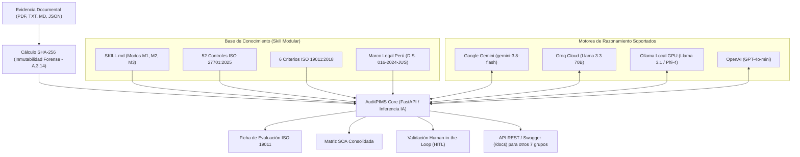

# 🛡️ AuditPIMS: Agente de Evidencia y Auditoría de Sistemas

> **Plataforma Agéntica de Auditoría Interna, Integridad Criptográfica y Evaluación de Evidencias para Sistemas de Gestión de Privacidad de la Información (PIMS).**  
> Basada en **ISO/IEC 27701:2025**, directrices de auditoría **ISO 19011:2018** y la normativa de protección de datos personales de Perú (**Ley N.º 29733** y nuevo reglamento **D.S. N.º 016-2024-JUS**).

---

## 🏛️ Información Institucional
* **Universidad:** Universidad Nacional de San Agustín de Arequipa (UNSA)
* **Facultad:** Facultad de Ingeniería de Producción y Servicios
* **Escuela Profesional:** Ingeniería de Sistemas
* **Curso:** Auditoría de Sistemas (2026)
* **Docente:** Edward Vicente Zarate Carlos
* **Equipo (Grupo 04 - Agente de Evidencia y Auditoría):**
  * Bernahola Vilca, Piero Javier
  * Contreras Huamani, Paul Michaell
  * Soncco Mamani, Max Junior
  * Velasque Arcos, Mikhail
  * Quispe Madariaga, Jeferson

---

## 🎯 Propósito del Agente en el Ecosistema Multiagente
En el ecosistema PIMS del curso (compuesto por 8 agentes distribuidos entre los grupos del salón), **AuditPIMS actúa como el Agente Juez y Auditor Interno**. Su responsabilidad es auditar de forma autónoma los artefactos producidos por los demás agentes (políticas, registros de consentimiento, DPIA, procedimientos de incidentes), garantizando:
1. **Cadena de custodia e integridad forense:** Cálculo en tiempo real de hashes criptográficos **SHA-256** de cada evidencia antes de su análisis (Control A.3.14).
2. **Evaluación objetiva según ISO 19011:** Verificación estricta de los 6 criterios periciales (*Pertinencia, Suficiencia, Vigencia, Aprobación, Trazabilidad y Completitud*).
3. **Control de cumplimiento legal peruano:** Detección automática de desviaciones críticas (p. ej., plazos de notificación de brechas en **48 horas** según D.S. 016-2024-JUS vs. el estándar europeo de 72h).
4. **Gobernanza Human-in-the-Loop (HITL):** El agente propone el dictamen pericial y el Auditor Líder humano lo valida, ajusta o firma.

---

## 🏗️ Arquitectura del Sistema



---

## 📁 Estructura del Repositorio

```text
AUDITORIA/
├── auditoria-evidencias-pims/      # Skill modular del agente
│   ├── SKILL.md                   # Definición de modos M1, M2 y M3
│   ├── references/                # Base de conocimiento normativo
│   │   ├── controles_iso27701.md  # 52 controles para RT y EN
│   │   ├── criterios_evaluacion.md# 6 criterios formales ISO 19011
│   │   └── ley29733_resumen.md    # Ley 29733 y D.S. 016-2024-JUS (48h)
│   └── assets/                    # Plantillas de matriz y dictamen
├── app_dashboard.py               # Dashboard Web FastAPI (UI Ejecutivo Cálido)
├── auditor_con_ia.py              # Script CLI para auditoría con IA en vivo
├── probar_auditor.py              # Banco de pruebas automatizado offline (E1 a E8)
├── documento_prueba_contrato.txt  # Evidencia real de prueba: Contrato Telecall
├── documento_prueba_politica.txt  # Evidencia real de prueba: Política 2026
├── GUION_EXPOSICION_GRUPO4.md     # Guion de defensa técnica minuto a minuto
├── requirements.txt               # Dependencias de Python
└── README.md                      # Documentación del proyecto
```

---

## ⚡ Guía de Instalación y Uso Rápido

### 1. Clonar el repositorio e instalar dependencias
```bash
git clone https://github.com/Piero-design/AuditPIMS.git
cd AuditPIMS
python3 -m pip install -r requirements.txt
```

### 2. Configurar la clave de IA (Opcional si usas el modo local/simulador)
```bash
export GEMINI_API_KEY="tu_clave_de_google_ai_studio"
# O bien:
# export GROQ_API_KEY="tu_clave_de_groq"
# export OPENAI_API_KEY="tu_clave_de_openai"
```

### 3. Levantar el Dashboard Web Ejecutivo
```bash
python3 app_dashboard.py
```
Abre en tu navegador:
* 🖥️ **Dashboard Web:** [http://localhost:8000](http://localhost:8000) *(Diseño cálido, editorial, blanco y ámbar).*
* 📑 **Documentación Interactiva Swagger:** [http://localhost:8000/docs](http://localhost:8000/docs).

---

## 💻 Uso por Línea de Comandos (CLI)

### Auditar un archivo físico en tiempo real con IA:
```bash
python3 auditor_con_ia.py --archivo documento_prueba_contrato.txt
```

### Probar el banco de casos predeterminados offline:
```bash
# Evaluar caso E6 (Detección de trampa legal de 72h vs 48h):
python3 probar_auditor.py --evaluar E6

# Evaluar caso E8 (Regla: Sin evidencia no hay conformidad):
python3 probar_auditor.py --evaluar E8

# Consolidar matriz completa (Modo M3):
python3 probar_auditor.py --consolidar
```

---

## 🌐 Protocolo de Integración Multiagente (API REST)
Los otros 7 grupos del curso pueden enviar sus entregables mediante una petición HTTP POST:

```bash
curl -X POST "http://localhost:8000/api/auditar" \
  -H "Content-Type: application/json" \
  -d '{
    "nombre_archivo": "DPIA_Evaluacion_Riesgos_Grupo3.txt",
    "contenido": "Texto completo del documento...",
    "proveedor": "gemini"
  }'
```

### Respuesta recibida (JSON estructurado):
```json
{
  "exito": true,
  "proveedor_usado": "Google Gemini (gemini-3.8-flash)",
  "tiempo_segundos": 2.15,
  "sha256": "0748853a3de830295ddaedeb85c66795564e2726e350e6aac83f64837749f507",
  "severidad": "NO CONFORMIDAD MAYOR",
  "dictamen_markdown": "### FICHA DE EVALUACIÓN DE EVIDENCIA..."
}
```

---

## 📜 Licencia y Propósito Académico
Desarrollado con fines exclusivamente académicos para el curso de **Auditoría de Sistemas** de la **Universidad Nacional de San Agustín (UNSA)**, Semestre 2026.
